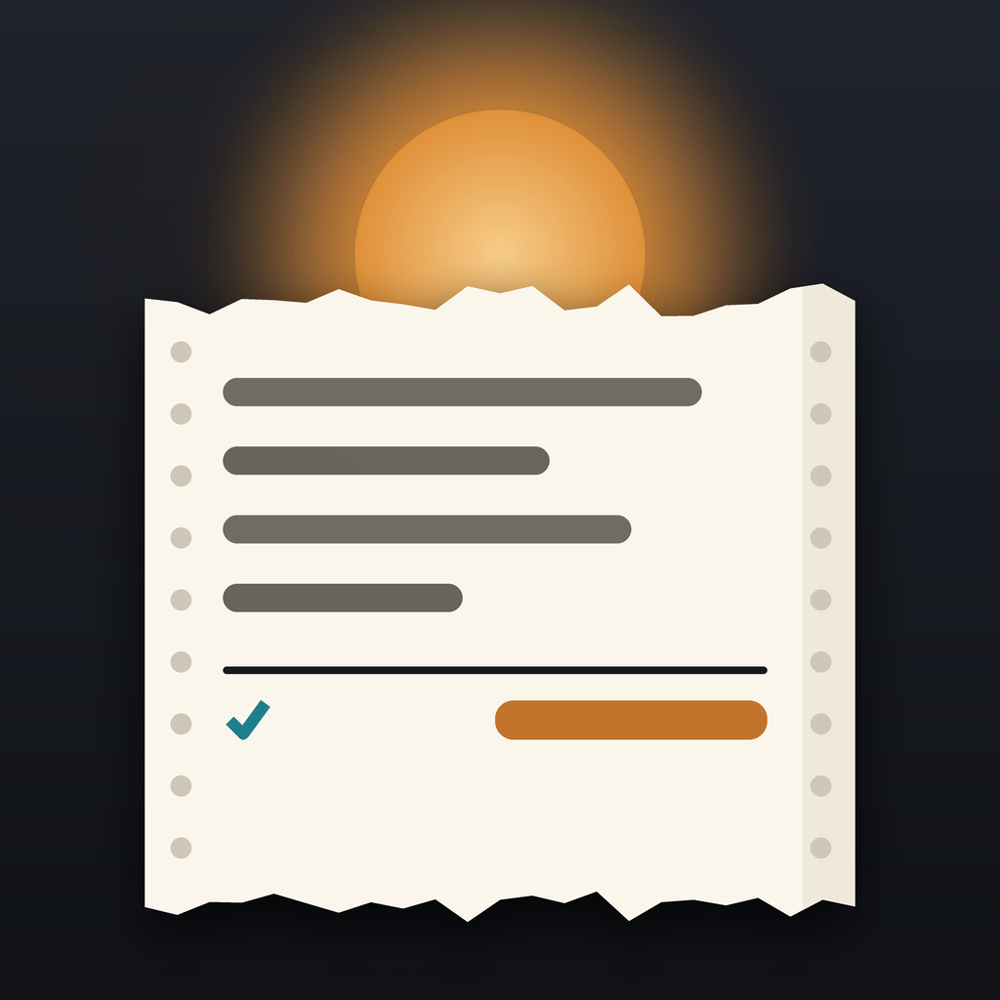

# Blocgenda

[](https://github.com/boboul-cloud/blocgenda/actions/workflows/ci.yml)
[](https://www.apple.com/fr/ios/)
[](https://swift.org)
[](LICENSE)

**[Site](https://boboul-cloud.github.io/blocgenda/)** ·
[Confidentialité](https://boboul-cloud.github.io/blocgenda/confidentialite.html) ·
[Conditions](https://boboul-cloud.github.io/blocgenda/conditions.html) ·
[Assistance](https://boboul-cloud.github.io/blocgenda/assistance.html)

Un bloc-notes qui pense comme une additionneuse de comptoir : **une bande de
papier sans fin** sur laquelle s'impriment, dans l'ordre où ils arrivent, vos
calculs, vos notes, vos actions et vos rendez-vous. Autour de cette bande,
l'application donne chaque jour l'état du monde autour de vous : éphéméride,
lever et coucher du soleil, marée du lieu où vous êtes, lune, météo.

Application iOS native, SwiftUI + WidgetKit, entièrement en français.



---

## L'idée

Un bloc-notes classique vous oblige à choisir : est-ce une note, une tâche, un
calcul, un rendez-vous ? Blocgenda ne demande rien. **Il y a une seule barre de
saisie**, et l'application devine :

| Ce que vous écrivez | Ce qui s'imprime |
|---|---|
| `12,50 × 3` | un calcul, résultat aligné à droite, qui entre dans le total |
| `200 + 10%` | 220 — les pourcentages se comportent comme sur une calculatrice de bureau |
| `20% de 80` | 16 |
| `- rappeler le garage` | une action à cocher |
| `- passer à la poste demain 10h` | une action **et** son rappel dans l'agenda |
| `demain 14h30 dentiste` | un rendez-vous, avec notification |
| `réunion lundi 9h pendant 2h` | un rendez-vous de deux heures |
| `12/09 8h contrôle technique` | un rendez-vous à la date dite |
| `essence 62,30` | une note chiffrée, comptée dans le total du jour |
| `courses 41,15 #maison` | la même, étiquetée |

La barre affiche en direct ce qu'elle a compris, **avant** que vous validiez :
pas de mauvaise surprise.

---

## Les quatre écrans

### 1. Rouleau

La bande de papier, avec ses perforations, son grain et son bord déchiré. En
haut, l'afficheur du **total en cours** ; en bas, la barre unique et, au besoin,
le **clavier de calculatrice** (`C`, parenthèses, `%`, `TVA`, `TOTAL`).

- `TOTAL` imprime un trait de sous-total et repart de zéro, comme sur une caisse.
- Les **ciseaux** déchirent la bande : les lignes terminées sont archivées et
  Blocgenda produit **une image du ticket**, prête à être envoyée ou rangée dans
  vos photos. Les actions non faites et les lignes épinglées restent sur le rouleau.
- Recherche plein texte, y compris sur les `#étiquettes`.
- Appui long sur une ligne : épingler, modifier, copier, supprimer.

### 2. Le jour

- **Course du soleil** : un arc où le disque avance en temps réel ; lever,
  coucher, durée du jour et l'écart avec la veille (« +3 min qu'hier »).
- **Marée** : la courbe des 24 heures, les pleines et basses mers avec leur
  hauteur, le sens de la marée en cours, le marnage, vive-eau / morte-eau.
  Si vous n'êtes pas sur la côte, l'application bascule d'elle-même sur le port
  de référence le plus proche et le dit.
- **Lune** : phase dessinée, éclairement, âge, lever et coucher, prochaines
  pleine et nouvelle lunes.
- **Éphéméride** : saint du jour, dicton, jour n° X de l'année, semaine,
  jours restants, jours fériés (Pâques comprise, calculée), et « ce jour-là ».
- **Anniversaires** tirés de l'annuaire, avec l'âge et le bouton d'appel.
- **Lumière** : heure dorée du matin et du soir, heure bleue, nuit noire —
  le créneau des photographes, avec un repère « en cours ».
- **Activité (pêche & nature)** : périodes solunaires majeures et mineures,
  calculées à partir du passage de la lune au méridien et de son lever/coucher,
  plus une note du jour sur quatre.
- **Météo** : température, ressenti, vent en km/h, rose des vents et force Beaufort.

### 3. Agenda

Bande des sept jours (points de densité sous chaque date, balayage pour changer
de semaine), liste de la journée, récurrences (quotidien, jours ouvrés,
hebdomadaire, quinzaine, mensuel, annuel), rappels multiples, couleur, lieu,
rattachement à un contact.

**La barre unique est aussi présente ici**, et écrit dans le jour sélectionné :
sur un jour à venir, « 9h » désigne neuf heures ce jour-là. Ce qu'on écrit
apparaît sous les rendez-vous, dans une section « Sur le rouleau ».

### 4. Annuaire

Fiches groupées (Famille, Mer, Santé, Maison…), favoris, recherche, et les
gestes utiles en un pouce : appeler, écrire, envoyer un courriel, ouvrir le plan.
Les anniversaires renseignés ici remontent dans l'éphéméride.

---

## Widgets et notifications

**Deux widgets**, en petit, moyen, grand, plus l'écran verrouillé :

- **Le jour** — date, saint, soleil, prochain rendez-vous, actions, total du
  rouleau, marée et anniversaires en grand format. En format moyen, la première
  action non faite est **cochable directement depuis le widget** (App Intent),
  sans ouvrir l'application.
- **Marée** — la prochaine pleine ou basse mer, sa hauteur et le décompte ;
  version circulaire pour l'écran verrouillé.

**Notifications :**

- rappels de rendez-vous (plusieurs par événement) ;
- **le point du matin** — saint du jour, soleil, lieu ;
- **le bilan du soir** — l'invitation à faire le point sur le rouleau ;
- alerte **heure dorée** (15 min avant) ;
- alerte **marée** (1 h avant chaque étale).

**Liens profonds** : `blocgenda://rouleau`, `blocgenda://jour`,
`blocgenda://agenda`, `blocgenda://annuaire`, `blocgenda://reglages` —
utilisables depuis Raccourcis.

---

## Construire et lancer

Prérequis : macOS avec Xcode 16 ou plus, et [XcodeGen](https://github.com/yonaskolb/XcodeGen)
(`brew install xcodegen`).

```bash
xcodegen generate          # produit Blocgenda.xcodeproj
open Blocgenda.xcodeproj   # puis ⌘R
```

Sur simulateur, sans compte développeur :

```bash
xcodebuild -project Blocgenda.xcodeproj -scheme Blocgenda \
  -sdk iphonesimulator -destination 'name=iPhone 17' \
  CODE_SIGNING_ALLOWED=NO build
```

**Sur un iPhone réel**, dans Xcode : sélectionnez votre équipe dans *Signing &
Capabilities* pour les deux cibles (`Blocgenda` et `BlocgendaWidget`). Le groupe
d'app `group.com.oulhen.blocgenda` doit être actif sur les deux — la signature
automatique le crée. Si le préfixe `com.oulhen` est déjà pris, changez-le dans
`project.yml`, `Resources/*.entitlements` et `SharedStorage.appGroup`, puis
relancez `xcodegen generate`.

Vérifier le moteur (calculatrice, langage naturel, éphémérides solaires) sans
lancer le simulateur :

```bash
./Tools/run-engine-tests.sh
```

Piloter réellement l'application (parcours de saisie, agenda) :

```bash
xcodebuild test -project Blocgenda.xcodeproj -scheme Blocgenda \
  -destination 'name=iPhone 17' CODE_SIGNING_ALLOWED=NO \
  -only-testing:BlocgendaUITests
```

Régénérer l'icône :

```bash
python3 Tools/make_icon.py    # 1024 × 1024, RVB strict, sans canal alpha
```

---

## L'icône

`Tools/make_icon.py` dessine l'icône par le code (Pillow), en suréchantillonnant
×4 pour l'anticrénelage : une bande de papier déchirée en haut et en bas, ses
perforations, ses lignes imprimées, le trait ambré du total et la coche de
l'agenda ; derrière, le soleil de l'éphéméride qui se lève.

Le fichier produit est **1024 × 1024, mode RVB, sans canal alpha** — conforme à
l'exigence de l'App Store. Le script le vérifie à l'écriture, et on peut le
contrôler à part :

```
$ sips -g pixelWidth -g pixelHeight -g hasAlpha Resources/Assets.xcassets/AppIcon.appiconset/icon-1024.png
  pixelWidth: 1024
  pixelHeight: 1024
  hasAlpha: no
```

---

## Comment c'est fait

```
project.yml                     description du projet (XcodeGen)
Resources/                      Info.plist, entitlements, catalogue d'assets, icône
Sources/
  Shared/                       compilé dans l'app ET dans le widget
    Models/                     TapeEntry, AgendaEvent, Contact, Place
    Engine/
      Calculator.swift          analyseur d'expressions (descente récursive)
      SmartInput.swift          reconnaissance d'intention + dates en français
      Astronomy.swift           soleil et lune (algorithmes de Meeus)
      Solunar.swift             périodes d'activité
      Tides.swift               marées (Open-Meteo) + détection des étales
      Weather.swift             météo (Open-Meteo)
    Data/Ephemeris.swift        saints, dictons, jours fériés, « ce jour-là »
    Store/                      état, persistance, photographie pour le widget
    Services/                   position, notifications, App Intent, chargeur du jour
    Design/Theme.swift          couleurs, typographie, papier, bord déchiré
  App/                          les quatre écrans + réglages
  Widget/                       widgets écran d'accueil et écran verrouillé
Tools/                          générateur d'icône, tests du moteur
```

**Astronomie sans réseau.** Le soleil et la lune sont calculés sur l'appareil
(Meeus). Vérification pour Brest le 7 août 2026 : lever 07h01, coucher 21h48 —
conforme aux éphémérides publiées. L'application reste donc utilisable en mer ou
hors couverture ; seules la marée et la météo demandent Internet.

**Détection des étales.** La série horaire du niveau de la mer est parcourue à la
recherche de ses extrêmes locaux, puis l'instant exact de chaque pleine ou basse
mer est affiné par interpolation parabolique sur trois points — d'où des heures
à la minute plutôt qu'à l'heure ronde.

**Persistance.** Quatre fichiers JSON dans le conteneur du groupe d'app, plus
une `snapshot.json` compacte que le widget lit sans réveiller l'application.
L'écriture est différée de 400 ms pour que la frappe au clavier ne provoque pas
un accès disque à chaque caractère. Si le groupe d'app n'est pas disponible
(projet non signé), tout bascule proprement sur *Application Support*.

---

## Vie privée

Tout reste sur l'appareil. Aucun compte, aucune analytique, aucun serveur.
Les seules requêtes réseau vont à **Open-Meteo** (service libre, sans clé) pour
la marée et la météo, et n'envoient que des coordonnées arrondies au dix-millième
de degré. La position est demandée en précision « kilomètre » : la commune suffit
pour une éphéméride.

---

## Limites connues

- Les hauteurs de marée sont données **par rapport au niveau moyen de la mer**,
  d'après un modèle de prévision. C'est bon pour organiser sa journée ; **pour
  naviguer, utilisez l'annuaire officiel des marées (SHOM)**. L'indication
  vive-eau / morte-eau est déduite de la phase de la lune, ce n'est pas le
  coefficient officiel.
- La couverture marine d'Open-Meteo s'arrête au large des côtes : à l'intérieur
  des terres, l'application propose le port de référence le plus proche parmi
  les vingt-cinq embarqués (métropole et outre-mer).
- La répétition mensuelle se cale sur le quantième : un événement du 31 ne tombe
  pas dans les mois courts.
- iOS plafonne les notifications locales en attente à 64 ; Blocgenda en
  programme au plus 56 pour les rendez-vous, sur trois semaines glissantes, et
  reconstruit la file à chaque modification.
- Interface en français uniquement.

---

## Autour du code

| | |
|---|---|
| [`docs/`](docs/) | Le site public, servi par GitHub Pages : présentation, confidentialité, conditions, assistance, mentions légales. |
| [`CHANGELOG.md`](CHANGELOG.md) | Le journal des versions. |
| [`CONTRIBUTING.md`](CONTRIBUTING.md) | Comment signaler un bug ou proposer une correction. |
| [`SECURITY.md`](SECURITY.md) | Comment signaler une faille, et le modèle de menace. |
| [`Marketing/app-store.md`](Marketing/app-store.md) | La fiche App Store prête à coller, et la liste de contrôle avant dépôt. |
| [`.github/workflows/ci.yml`](.github/workflows/ci.yml) | Tests du moteur, compilation sans avertissement, vérification de l'icône. |

## Licence

**© 2026 Bob Oulhen. Tous droits réservés.**

Le code est publié pour que chacun puisse vérifier ce que l'application fait de
ses données, et le compiler pour son usage personnel. Ce n'est **pas** une
licence open source : la redistribution, la réutilisation dans un autre logiciel
et l'exploitation commerciale sont soumises à autorisation écrite.
Voir [`LICENSE`](LICENSE).

Les données de marée et de météo proviennent d'[Open-Meteo](https://open-meteo.com)
(CC BY 4.0).
